

  

  
  

  

## Proyectos destacados

### DatHua · Líder del proyecto y programador
**Plataforma SaaS de monitoreo de redes para PyMEs.** Detecta fallas antes de que el negocio se detenga y las explica.

- Dirijo el proyecto y programo de punta a punta: requerimientos, arquitectura, desarrollo y documentación técnica.
- **Backend:** API REST en Node.js/Express 5 con 62 endpoints, MySQL + MongoDB, eventos en tiempo real con Socket.IO, tareas programadas y arquitectura multiempresa con autenticación JWT.
- **Agentes de sistema:** servicio de Windows y servicio de Linux con systemd que monitorean los equipos de la red mediante ICMP, SNMP y LLDP. El agente de Linux cuenta con 29 pruebas automatizadas en pytest.
- **Análisis de datos:** motor en Python que detecta anomalías con EWMA, CUSUM y percentiles.
- **Frontend:** dashboard en Vue 3 + Tailwind + Pinia con reportes en PDF/CSV.

  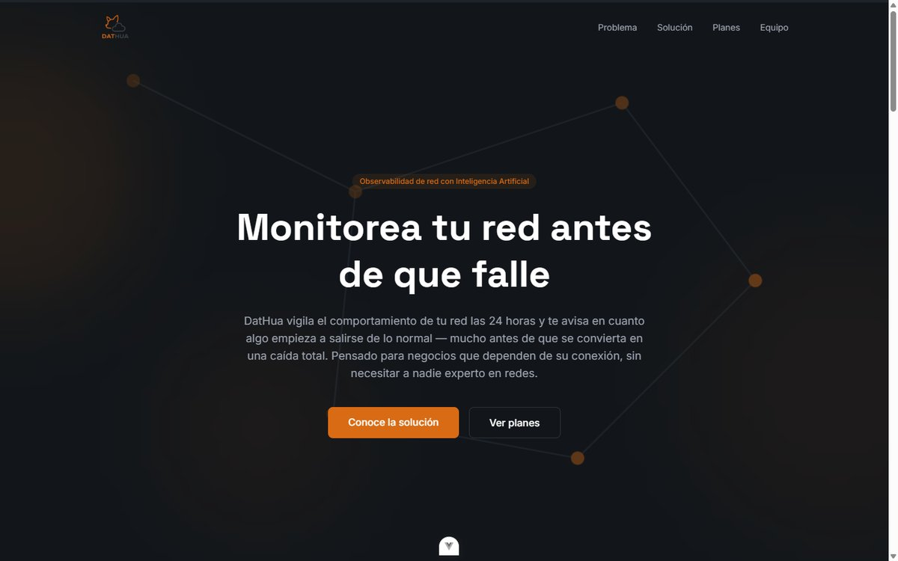
  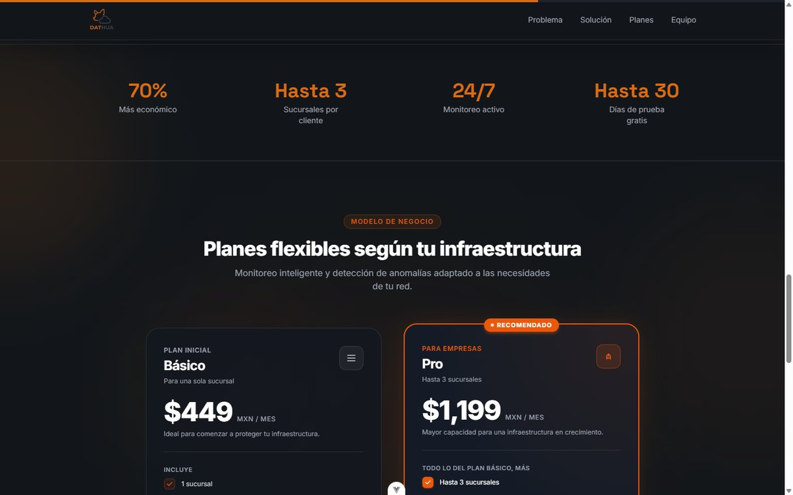

<b>Ver arquitectura y modelo de datos</b>

 

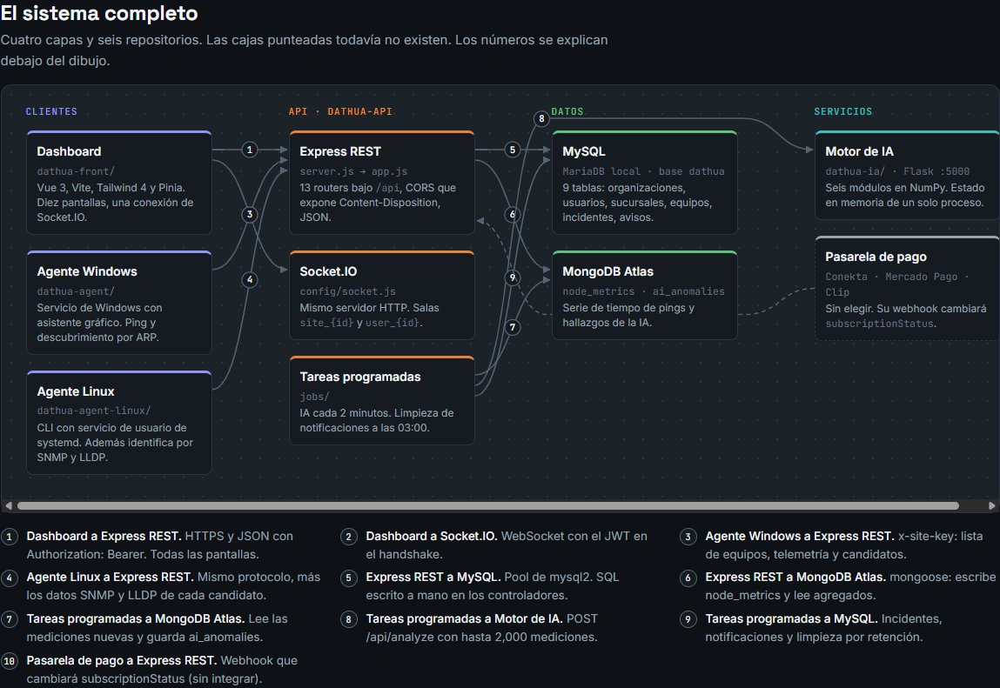

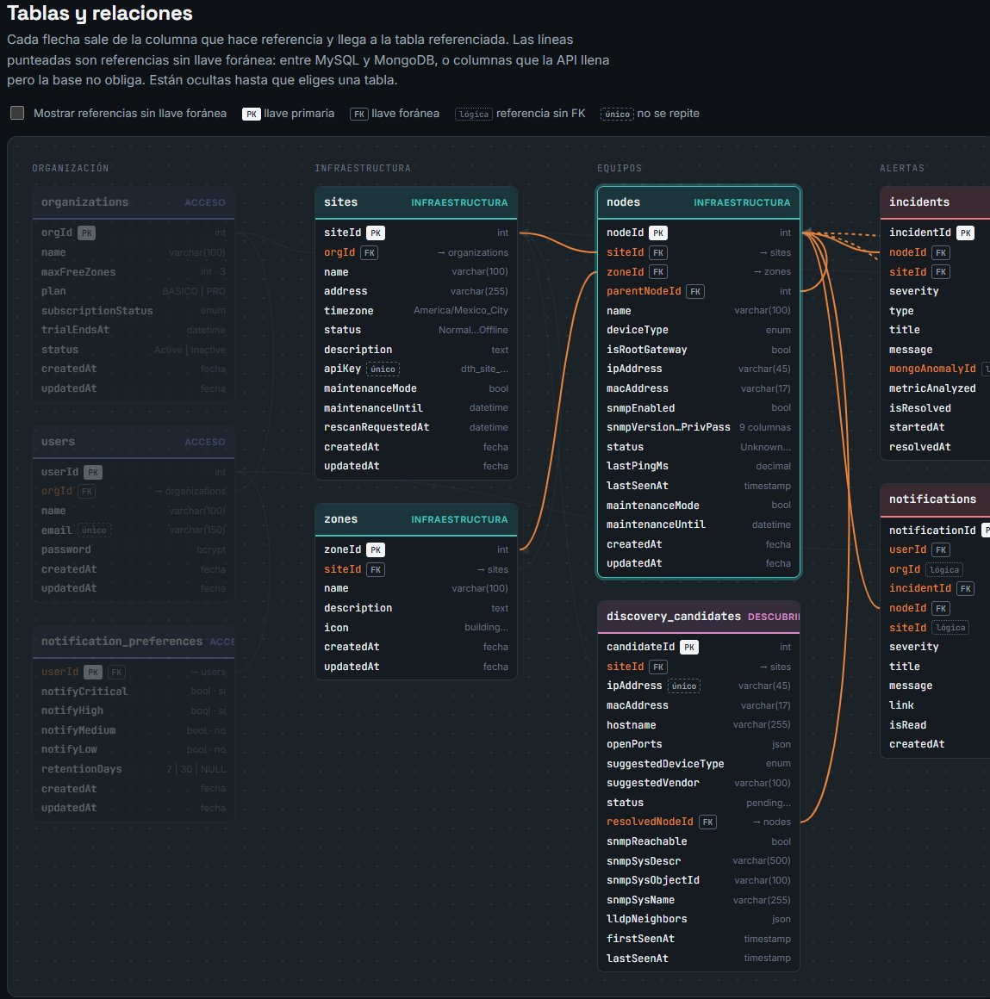

### SIMEI · Responsable de backend y nube
**Sistema de gestión de incidencias y mantenimiento para una facultad de la UAQ.** Proyecto en equipo; desarrollé la mayor parte del backend y la integración con la nube.

- **Base de datos en Supabase (PostgreSQL):** 9 migraciones versionadas; cambios de estado solo mediante funciones RPC; tablas de historial y auditoría inmutables; sin borrados en cascada.
- **API en Node.js/Express 5** con 47 endpoints y validación de esquemas. El frontend se comunica únicamente con la API y la base aplica los permisos de cada rol.
- **Nube:** Supabase Auth, Storage (fotos comprimidas a WebP con URL firmadas de 5 minutos), Realtime para notificaciones y pg_cron para procesos automáticos.
- **Calidad:** 24 suites de pruebas de SQL y de API, validadas contra Supabase real.
- **Trabajo en equipo:** administro el repositorio con forks y pull requests que reviso y apruebo. Hice una publicación de prueba con un túnel de Cloudflare; el despliegue en los servidores de la universidad está en camino.

  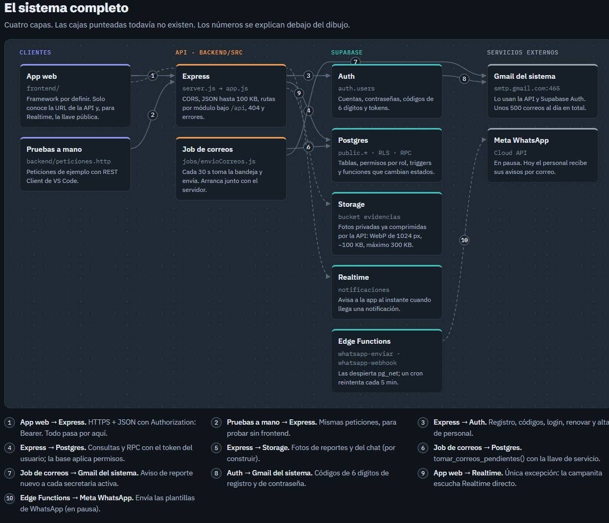
  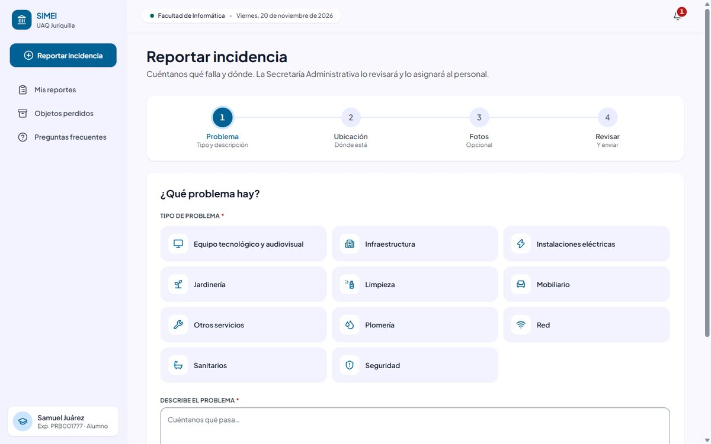

<b>Ver modelo de datos, sistema de diseño y versión móvil</b>

 

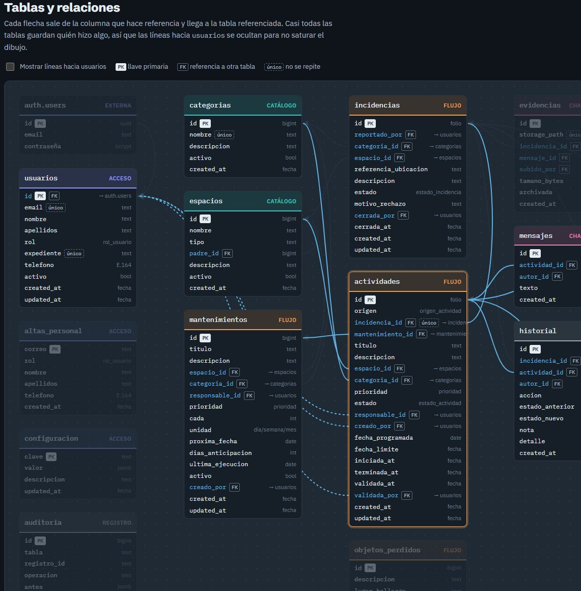

  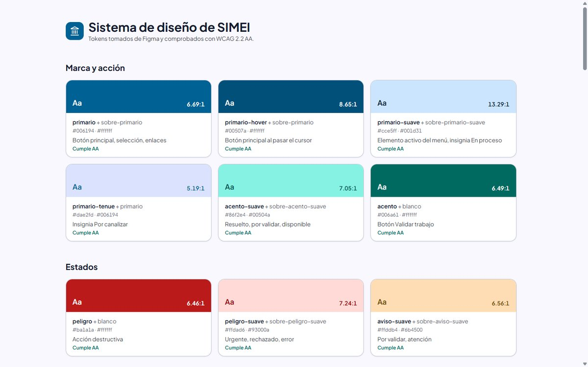
  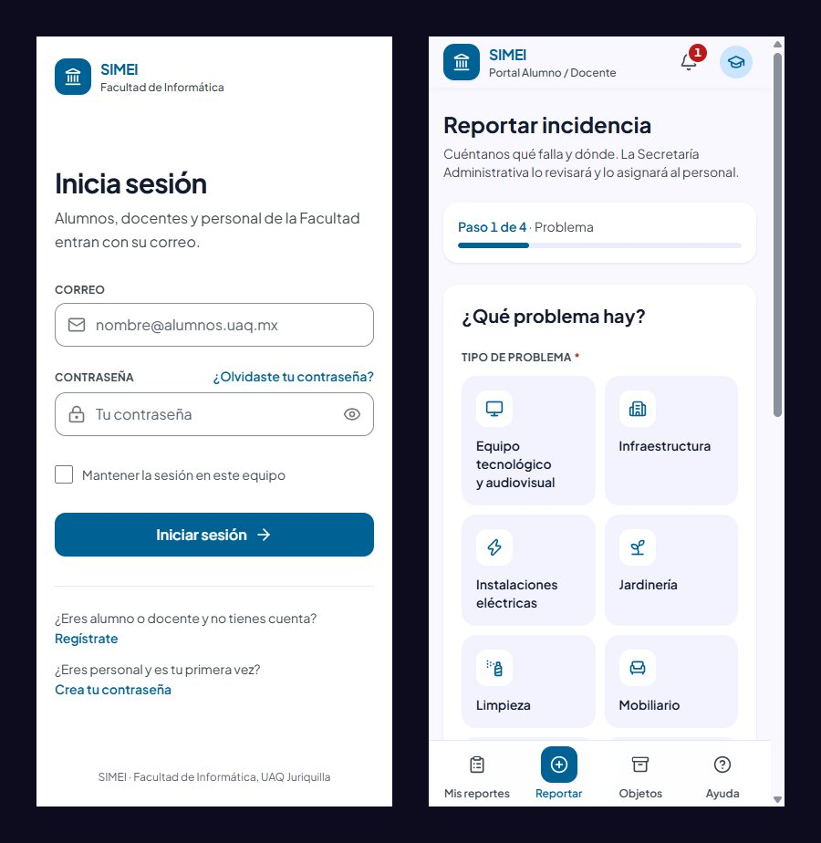

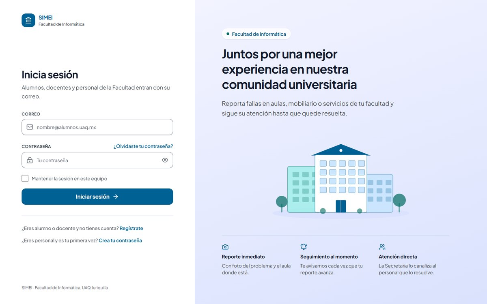

## Ciberseguridad

- Principio de mínimo privilegio en la base de datos: permisos por rol aplicados en PostgreSQL, funciones `security definer` con `search_path` fijo.
- Ningún secreto en el código: variables de entorno y solo archivos `.env.example` en los repositorios.
- Límite de intentos en el inicio de sesión, tokens JWT y auditoría inmutable de cambios.
- Formación en redes y seguridad con Cisco Networking Academy.

## Linux e infraestructura

- Administro un servidor con **Arch Linux** de forma remota: SSH, VPN con Tailscale y servicios con systemd.
- Experiencia con AWS (Cloud Foundations), Azure Functions, Supabase y Cloudflare.

## Tecnologías

   
  

  

## Certificaciones

| Insignia | Emisor |
|---|---|
| Introduction to Cybersecurity | Cisco |
| Networking Basics | Cisco |
| Networking Devices and Initial Configuration | Cisco |
| English for IT 1 | Cisco |
| Cloud Foundations | AWS Academy |

[Verificar en Credly](https://www.credly.com/users/samuel-juarez.f38478c9)

## Actividad en GitHub

  
  

  

Próximamente: página con mis actividades y proyectos.

